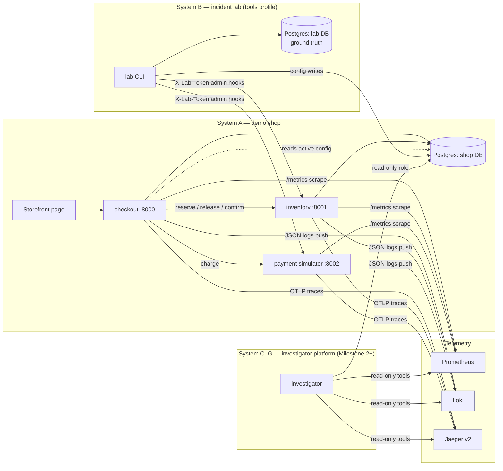

# IncidentForge — architecture and design decisions

IncidentForge is a **controlled incident-response research platform**. It runs a
small demo shop, injects labelled synthetic faults into it, and (from Milestone
2 on) lets an LLM investigator diagnose them from real telemetry and propose
bounded, human-approved repairs. It is not a general agent for fixing arbitrary
production systems.

## System map



The control plane (forge-api, forge-worker), the validation sandbox (sandbox-* services on an internal network) and the web UI are implemented; see docs/backend-guide.md and docs/security.md. Runtime status: PROJECT_STATUS.md.

## Key design decisions (and why)

| Decision | Reason |
|---|---|
| **Runtime config lives in Postgres as immutable versions** (`config_versions`) with an append-only `change_events` log. Checkout reads the active version with a 3 s cache. | Configuration faults become realistic and investigable: every change has a version, an actor, a timestamp and a diff. Rollback is a *roll-forward* to a copy of an older payload, so history is never rewritten. `expected_active_version` gives optimistic concurrency, which Milestone 3 uses to reject stale approvals. |
| **Dependency outcome labels** (`success`, `connect_error`, `timeout`, `http_404`, `http_4xx`, `http_5xx`, `bad_response`) on every outbound call, plus the **target host:port** in failure logs. | This is the evidence that separates "the payment service is failing" (5xx/timeout from a reachable, healthy target) from "checkout is misconfigured" (connect errors toward a target nobody serves, while payment's own health and traffic look normal or idle). |
| **Smallest observability stack: Prometheus + Loki + Jaeger v2** (no Grafana, no OTel Collector). | Three backends cover the three tool families (metrics, logs, traces), each with a simple HTTP query API. Jaeger v2 receives OTLP directly; logs go to Loki's native push API. Grafana adds UI only, and a collector adds a hop with no investigation value at this scale. |
| **Logs go to Loki through a custom bounded handler**, not the OTel logs SDK. | The Python OTel logs API has changed between releases. Loki's push API is stable. Trace correlation is kept: every JSON line carries the OTel `trace_id`/`span_id`. The handler never blocks requests: bounded queue, drop-and-count on overflow, background flush with timeouts. |
| **Framework-free core logic** (checkout orchestrator, lab controller, config schema, redaction, fault decisions). | Business rules and safety-relevant logic can be unit-tested with fakes, without a running stack; the FastAPI/SQLAlchemy layers are thin adapters. |
| **Compensation instead of distributed transactions.** A failed charge releases the stock hold; the order is marked `failed` with a machine-readable reason. | Standard saga pattern; it also makes S1 clean to verify (stock is unchanged after failures). |
| **Payment calls are idempotent** (the order ref is the `Idempotency-Key`), so the single retry is safe. | A retry on a non-idempotent charge could double-charge; this demo models the correct pattern. |
| **One Docker image with build targets** (`shop`, `lab`); the investigator image (Milestone 2) will not contain `lab/`. | Ground truth physically lives only in the lab image and the lab database. A unit test asserts that the `shop` stage does not copy `lab/`. |
| **Separate Postgres databases and roles**: `shop/shop_app`, `lab/lab_admin`. | The lab can write config (it injects faults) but cannot delete rows; the shop role cannot connect to the lab DB. Verified against Postgres 16 during development. The investigator gets its own read-only role in Milestone 2. |
| **Fault hooks are admin endpoints gated by `LAB_ADMIN_TOKEN`** and disabled when the token is unset. | Fault injection stays separate from anything the investigator can call. Constant-time token comparison. |

## Data model (shop DB)

`products`, `reservations`, `reservation_items` (inventory) · `orders`,
`order_items` (checkout) · `config_versions`, `change_events` (config plane).
The schema is created by Alembic migration `0001`. The partial unique index
`uq_config_versions_one_active` guarantees at most one active version per service.

## Telemetry contract

| Signal | Name / query | Labels |
|---|---|---|
| Inbound requests | `shop_http_requests_total`, `shop_http_request_duration_seconds` | service, method, route template, status |
| Outbound calls | `shop_dependency_requests_total`, `shop_dependency_request_duration_seconds` | service, dependency, operation, outcome |
| Checkout result | `shop_checkout_orders_total` | status, reason |
| Config | `shop_runtime_config_version`, `shop_runtime_config_load_errors_total` | service, config_service |
| Logs | `{service="checkout"} \| json` | stream labels: service, app, level; JSON fields include request_id, trace_id, fields.* |
| Traces | Jaeger `/api/traces?service=checkout&tags={"error":"true"}` | resource service.name; span attr shop.request_id, shop.synthetic |

Cardinality is bounded on purpose: route templates, never raw paths; outcome
is a closed enum; request IDs live in logs and spans, never in metric labels.

## Resource requirements

Docker memory limits in `docker-compose.yml` add up to about **2.1 GB**. Expect
typical idle usage of 0.8–1.2 GB with 2 CPU cores. The development profile *is*
the default stack: the load generator and lab run only on demand (compose
profiles `load` and `tools`).

## Repository layout

```
shop/            System A: checkout, inventory, payment simulator, models, migrations, seed
lab/             System B: scenarios (private ground truth), controller, CLI
forge/           control plane: investigator, tools, remediation, validation, approvals, API, worker
web/             React + TypeScript + Vite incident-response UI
tools/           stdlib scripts: journey, loadgen, wait_ready
scripts/         acceptance tests against a running stack
observability/   Prometheus, Loki, Jaeger configs
deploy/          Postgres init
tests/unit  no services · tests/db  PostgreSQL · tests/live  Gemini (opt-in) · scripts/  stack-level acceptance
docs/            architecture, milestones, scenarios, (later) threat model, evaluation, API
```
