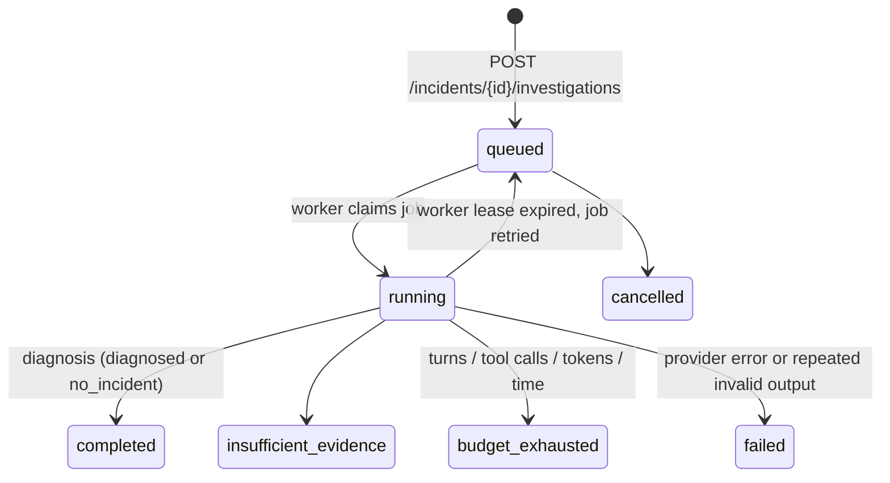
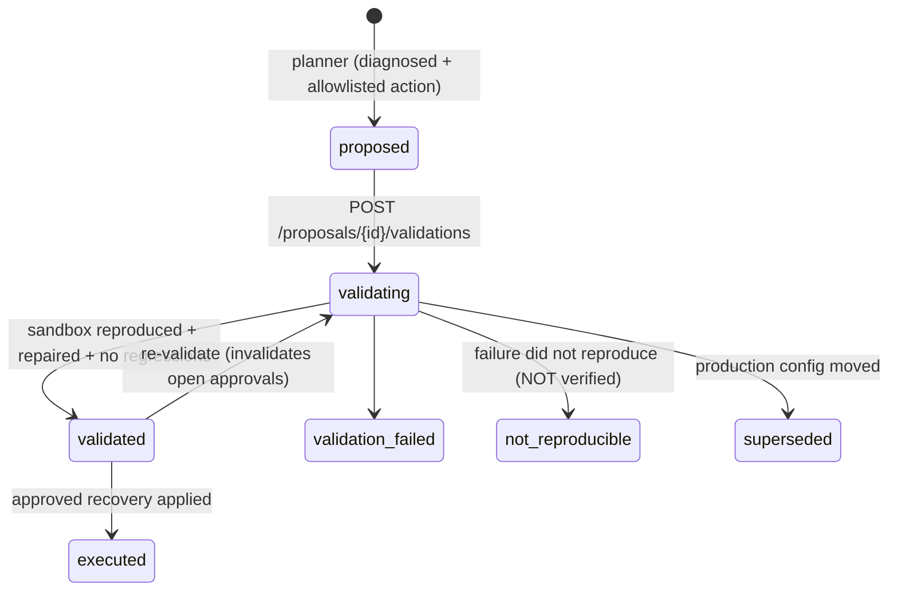
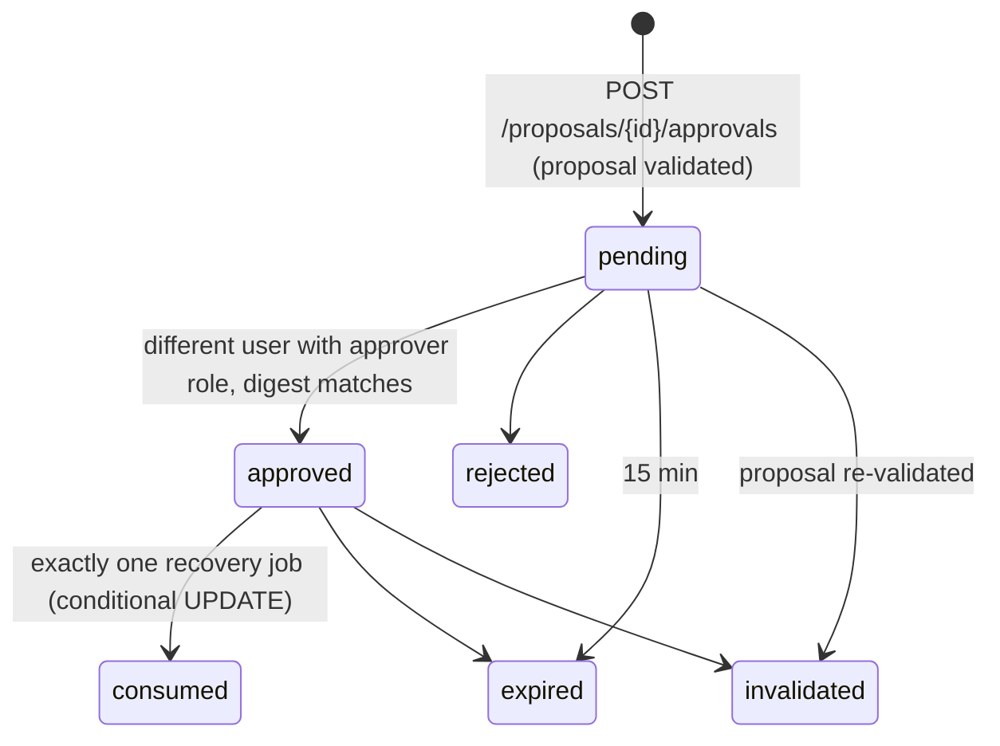

# State machines

Source of truth: `forge/domain/states.py` (illegal transitions raise and map to HTTP 409).

## Investigation



## Proposal → validation → approval → recovery





```mermaid
stateDiagram-v2
  [*] --> requested: POST /proposals/{id}/recovery (idempotent per proposal)
  requested --> executing: worker; re-checks digest + config version
  requested --> refused
  executing --> refused: preconditions changed / expected_active_version mismatch
  executing --> verifying: config written (forge_remediator)
  executing --> failed
  verifying --> succeeded: N synthetic checkouts pass
  verifying --> verification_failed: no automatic rollback (would be an unapproved write)
```

## Incident

`open → investigating → diagnosed → remediating → resolved`. `closed` is reachable from any non-terminal state
(closed without a verified repair). Failed investigations return the incident to `open`. Failed or refused
recoveries return it to `diagnosed`.
